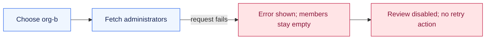
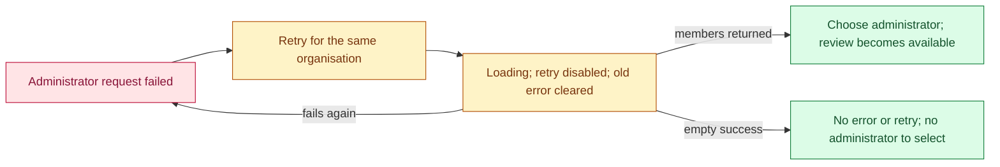

# Sotto #637: seeing the missing retry path

Status: proposed repair for review. The application code is unchanged.

## Colour and symbol key

| Mark | Meaning |
| --- | --- |
| 🔴 / red `-` line | Current failure path or a line proposed for removal |
| 🟢 / green `+` line | Proposed recovery path or a line proposed for addition |
| 🔒 | Prevent a second request while the first is pending |
| ⏳ | A request is still loading |
| Unmarked line | Existing context retained in the proposal |

The snippets below are explanatory excerpts. They are not edits already applied to the checkout.

## 1. Where the user gets stuck



Current request handling:

```tsx
setMembers([]);                    // administrator choices are cleared
setBusy(true);                    // controls are disabled while loading
try {
  setMembers(await fetchMembers(orgId));
} catch (e) {
  setError(message(e));            // failure is reported
} finally {
  setBusy(false);                  // loading ends, but choices are still empty
}
```

Reporting the error is correct. The missing pieces are a recovery action and discovery-specific state. The only existing route back to `fetchMembers` is changing the organisation selection.

## 2. Give administrator discovery its own state

```diff
 const [busy, setBusy] = useState(false);
 const [error, setError] = useState<string | null>(null);
+const [membersError, setMembersError] = useState<string | null>(null);
+const [membersLoading, setMembersLoading] = useState(false);
+const membersInFlight = useRef(false);
+const formBusy = busy || membersLoading;
```

- `error` continues to describe quote/submission failures.
- `membersError` identifies a failed administrator request that can be retried.
- `membersLoading` keeps the loading control visible after its old error is cleared.
- 🔒 `membersInFlight` changes immediately, so a second request cannot slip in before React renders the updated state.
- `formBusy` disables the existing form controls during either kind of operation.

## 3. Keep selection separate from loading

The organisation-selection handler would retain its existing reset work, then delegate the request:

```diff
 async function chooseOrganisation(orgId: string) {
+  if (membersInFlight.current) return;
   setDestinationOrgId(orgId);
   setCounterpartyId("");
   setMembers([]);
   setQuote(null);
   setError(null);
+  setMembersError(null);
   if (orgId === "") return;
-  setBusy(true);
-  try {
-    setMembers(await fetchMembers(orgId));
-  } catch (e) { setError(message(e)); }
-  finally { setBusy(false); }
+  await loadMembers(orgId);
 }
```

The extracted helper would be:

```diff
+async function loadMembers(orgId: string) {
+  if (orgId === "" || membersInFlight.current) return;
+  membersInFlight.current = true;
+  setMembersLoading(true);
+  setMembersError(null);
+  try {
+    setMembers(await fetchMembers(orgId));
+  } catch (e) {
+    setMembersError(message(e));
+  } finally {
+    membersInFlight.current = false;
+    setMembersLoading(false);
+  }
+}
```

🔒 Lock before the request; release the lock in `finally`, on success or failure.

The helper does not change `destinationOrgId`. Retrying therefore keeps the selected organisation. It calls only `fetchMembers`; requesting a quote and starting a transfer keep their existing separate handlers.

## 4. Add the missing recovery action

Add discovery feedback above the existing generic error:

```diff
+{membersError !== null && <p role="alert">{membersError}</p>}
+{(membersError !== null || membersLoading) && (
+  <button
+    disabled={formBusy}
+    onClick={() => void loadMembers(destinationOrgId)}
+  >
+    {membersLoading
+      ? "Loading administrators…"
+      : "Retry loading administrators"}
+  </button>
+)}
 {error !== null && <p role="alert">{error}</p>}
```

Existing personal-form controls would use `formBusy` in place of `busy` for their disabled conditions. The review button would still require both an organisation and an administrator.

```diff
-disabled={busy}
+disabled={formBusy}

-disabled={busy || destinationOrgId === "" || counterpartyId === ""}
+disabled={formBusy || destinationOrgId === "" || counterpartyId === ""}
```

## 5. What recovery looks like



## Behaviour to prove with tests

| Situation | Expected result |
| --- | --- |
| Initial administrator request fails | Accessible error and labelled retry control |
| Retry is pending | Same organisation; old error cleared; control disabled; one member request in flight |
| Retry fails again | Error and usable retry control return |
| Retry returns an owner/admin | Choices return; selecting one enables review |
| Retry returns an empty array | Successful empty state, without a failure message or retry control |
| Organisation changes or is cleared | Old discovery recovery state is cleared |
| Quote or submission fails | Its existing error is shown; no administrator-retry action is introduced |
| User retries administrator loading | No quote request and no transfer creation |

The next stage is a regression test that demonstrates the missing retry control against the original component. We have not added that test or applied this proposal yet.
